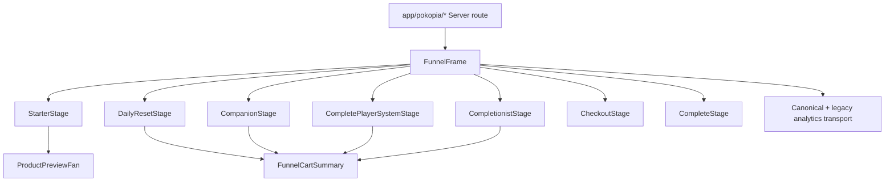

# Current Pokopia Funnel Architecture

Audit date: 2026-10-08. This is a repository audit, not a proposal or production-readiness approval.

## Evidence boundary

The current implementation is evidenced by the paths and symbols below. Line numbers refer to the audited working tree and should be rechecked if files change. The repository contains unrelated pre-existing working-tree changes; this audit does not treat them as funnel behavior.

## Runtime stack and routing

- Next.js App Router with React/TypeScript. Canonical pages are under `app/pokopia/*`; for example `app/pokopia/start/page.tsx:1-4` and `app/pokopia/checkout/page.tsx:1-15`.
- The funnel's interactive UI is layered as Client Components beneath Server Component route wrappers. `components/pokopia/PokopiaFunnelStage.tsx:1-14` defines the client shell, browser continuity, page-view tracking, progress indicator, and legacy event bridge.
- Canonical route wrappers perform server checks before rendering: P18 checks the journey or verified historical order in `app/pokopia/complete-player-system/page.tsx:16-29`; P17 checks `canViewP17Downsell` in `app/pokopia/completionist-kit/page.tsx:13-21`; checkout checks cumulative enablement, journey ownership, paid selection, and completion in `app/pokopia/checkout/page.tsx:6-15`.
- Legacy `/pokopia/funnel/*` pages use `permanentRedirect` to canonical routes, e.g. `app/pokopia/funnel/start/page.tsx:1-2`. The legacy mini-tool is a separate older page and is not part of the canonical cumulative route.

### Component hierarchy

Offer copy, prices, product IDs, preview paths, and enabled/readiness flags are centralized in `data/pokopia-funnel.ts:7-44`. `isOfferCheckoutReady` is a presentation/readiness helper at line 43; server route and cumulative readiness functions remain authoritative.

## Email capture and free access

`PokopiaStarterStage` renders the email form and secure-access form in `components/pokopia/PokopiaStarterStage.tsx:141-145`. Submission posts email, funnel session, and attribution to `/api/pokopia/funnel/start`.

`app/api/pokopia/funnel/start/route.ts:18-65`:

1. Normalizes and validates email.
2. Gets or creates a journey keyed by the HttpOnly `sf_pokopia_journey` cookie.
3. Creates/upserts a hashed Quick Start access token.
4. Persists lead email, attribution, Quick Start claim, and delivery status.
5. Records `pokopia_free_claimed`.
6. Subscribes through the configured email provider in `after()` and records sent/failed/not-configured status.
7. Sets journey, anonymous-ID, and Quick Start access cookies.

The exact provider abstraction is `lib/email/provider.ts`; the concrete provider is selected by `getEmailProvider`. Provider configuration was not inferred beyond the route's `subscribe` call: provider availability and downstream delivery are **NOT VERIFIED** here.

## Journey persistence and browser continuity

Browser state is explicitly non-authoritative: `lib/pokopia-funnel/state.ts:1-10` stores a session ID and last-step convenience state in `sessionStorage`.

Durable truth is a Supabase `funnel_journeys` row. `lib/pokopia-funnel/journey-repository.ts:22-57` creates, reads, updates with `journey_version` optimistic concurrency, and records `funnel_events`. The migration defines journey and event tables and RLS in `supabase/migrations/202609090001_create_pokopia_funnel_journeys.sql:1-24`; later migrations add cumulative fields, customer binding, revision, and lead-delivery fields.

## BUY, SKIP, and eligibility

`app/api/pokopia/funnel/journey/route.ts:38-77` is the transition reducer. BUY adds a normalized product selection; SKIP sets a branch flag but does not remove prior selections. POST re-loads the server journey, resolves customer context, calls `resolveP18Eligibility`, applies a transition, persists it, retries once after an optimistic-lock race, and records a durable event (`:80-107`).

Eligibility is server-side:

- Current-journey P18 eligibility requires an accepted P06 or P16 and rejects double-skip, bypassed, or completed journeys: `lib/pokopia-funnel/eligibility.ts:12-18`.
- Verified historical P06 ownership can also qualify a signed-in customer: `lib/pokopia-funnel/eligibility.ts:20-26`.
- P17 requires `p17Eligible`, a qualified P18 view, P18 skipped, and no bypass: `lib/pokopia-funnel/journey.ts:25-27`.
- Route pages repeat these checks before rendering, preventing a client-only eligibility decision.

## Cumulative cart and checkout

The canonical selection order is `P06`, `P16`, `P18`, `P17` and prices are defined in `lib/pokopia-funnel/cumulative.ts:8-24`. `normalizeSelectedProducts` deduplicates and reorders selections (`:30-35`); `getSelectedTotalCents` sums server-defined cents (`:35`); `addProductSelection` clears stale checkout state (`:37-38`).

Checkout integrity uses a SHA-256 fingerprint over journey ID, normalized products, currency, price version, and schema version (`:39-41`). The checkout route validates feature enablement, selection, product readiness, signed-in customer ownership, and allowlisted origin before creating/reusing a Stripe Checkout Session (`app/api/pokopia/funnel/checkout/route.ts:11-66`). Metadata carries journey, selected products, canonical total, fingerprint, and customer binding.

## Payment, order creation, and fulfillment

`app/api/stripe/webhook/route.ts:20-25` verifies Stripe signatures against the configured secret set. The accumulated-order branch validates metadata, journey state, line items, total, currency, and active fulfillment versions before calling `createOrderIdempotently` (`:36-64`). The standalone branch performs equivalent product/price checks and records historical fulfillment versions (`:78-125`).

`lib/orders/idempotency.ts:1-5` first looks up the Stripe session; the database also enforces unique provider session/event identifiers (`supabase/migrations/202608290001_create_orders.sql:1-24`). Entitlements are stored with product and optional fulfillment version in the order row.

`lib/delivery/service.ts:53-95` resolves versioned logical paths and creates one-hour Supabase signed URLs from the private bucket. The order download route requires authenticated customer context, paid order status, customer ownership, and an entitlement before signing URLs: `app/api/orders/[order-id]/downloads/[product-id]/route.ts:5-27`.

## Analytics and attribution

`FunnelFrame` emits legacy and canonical page events (`components/pokopia/PokopiaFunnelStage.tsx:14`). Client events go through `lib/analytics/transport.ts:18-67` and `/api/analytics/events`; server purchase events are recorded from the webhook through `lib/analytics/server.ts` and TikTok purchase dispatch. Event IDs and purchase uniqueness are backed by the analytics contract and `analytics_events` constraints (`supabase/migrations/202609280001_create_phase1_analytics.sql:11-100`). Attribution is captured in browser storage and persisted to journey/order fields.

## External evidence used

- Next.js App Router and server/client boundaries: [App Router](https://nextjs.org/docs/app), [Server and Client Components](https://nextjs.org/docs/app/getting-started/server-and-client-components).
- Stripe hosted Checkout: [Checkout quickstart](https://docs.stripe.com/payments/checkout/quickstarts); webhook guidance: [Webhooks](https://docs.stripe.com/webhooks).
- Supabase authorization: [RLS](https://supabase.com/docs/guides/database/postgres/row-level-security); [Storage access control](https://supabase.com/docs/guides/storage/security/access-control).

## Not verified by this audit

- Production domain routing and current public deployment behavior.
- Whether every configured email provider subscription delivers the promised email in production.
- Live Stripe webhook delivery, live storage object availability, and customer-visible signed downloads.
- Visual rendering at every requested viewport; source and available screenshot artifacts were inspected, but no claim of a complete visual test is made here.
