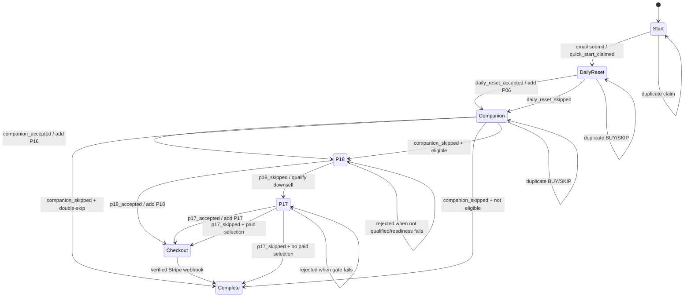

# Pokopia Funnel State Machine

This documents the current server transition system. It is not a proposed replacement.

## Durable state

The state shape is `PokopiaJourney` in `lib/pokopia-funnel/journey.ts:3-21`. It contains claim/view/BUY/SKIP/purchase flags for P06, P16, P18, and P17; selected products and total; checkout fingerprint/session; attribution; customer binding; and completion metadata. Browser `sessionStorage` is only continuity (`lib/pokopia-funnel/state.ts:1-10`).

## State diagram

## Transition rules

The reducer is `transition` in `app/api/pokopia/funnel/journey/route.ts:38-77`.

| Transition | Current behavior | Evidence |
|---|---|---|
| Quick Start claim | Sets `quickStartClaimed`, moves to daily reset | `route.ts:39` |
| P06 BUY | Sets accepted, clears skip, adds P06 | `route.ts:50` and `lib/pokopia-funnel/cumulative.ts:37-38` |
| P06 SKIP | Sets skip and moves to P16 | `route.ts:51` |
| P16 BUY | Sets accepted, adds P16, evaluates P18 | `route.ts:52` |
| P16 SKIP | Evaluates double-skip or P18 eligibility | `route.ts:53`, `:31-36` |
| P18 view | Requires resolved eligibility | `route.ts:42-45` |
| P18 BUY | Requires eligibility, qualified view, and readiness; adds P18 | `route.ts:54` |
| P18 SKIP | Requires eligibility and qualified view; enables P17 | `route.ts:55` |
| P17 view/BUY/SKIP | Requires `canViewP17Downsell`/`canActOnP17Downsell` | `lib/pokopia-funnel/journey.ts:26-27`, route `:46`, `:56-58` |
| Checkout | Requires paid selection and valid environment/readiness | `app/api/pokopia/funnel/checkout/route.ts:11-24` |
| Completion | Webhook marks paid journey complete; page action records terminal UI state | `app/api/stripe/webhook/route.ts:61-64`, `components/pokopia/PokopiaCompleteStage.tsx:8-12` |

## Eligibility invariants

1. P18 cannot be viewed or purchased solely because a browser submits an action. `resolveP18Eligibility` uses persisted journey state and verified historical P06 order ownership (`lib/pokopia-funnel/eligibility.ts:12-26`).
2. A current journey must have accepted P06 or P16. A double skip means both P06 and P16 were skipped without acceptance and permanently bypasses P18 for that journey (`journey.ts:25`; `route.ts:31-36`).
3. P17 can appear only after a qualified P18 view and a P18 skip, with no bypass (`journey.ts:26-27`).
4. Existing selections are never removed by SKIP. This is covered by the cumulative tests and implemented by `addProductSelection`/flag transitions.
5. A later action clears stale checkout state when the cart changes (`cumulative.ts:37-38`).

## Concurrency and replay behavior

`updatePokopiaJourney` uses `journey_version` optimistic concurrency (`lib/pokopia-funnel/journey-repository.ts:40-46`). The POST route re-reads and retries once after a stale-tab race (`app/api/pokopia/funnel/journey/route.ts:94-105`). Duplicate transitions are intentionally monotonic and normally return unchanged state.

Stripe retries are handled separately: `createOrderIdempotently` checks provider session identity before insert (`lib/orders/idempotency.ts:3-5`), while database unique constraints backstop provider session and event IDs (`supabase/migrations/202608290001_create_orders.sql:1-24`).

## State-machine discrepancies and uncertainty

- The route currently returns 404 for journey POST when cumulative checkout is disabled (`journey/route.ts:83`). This is intentional fail-closed staging behavior, but whether production activation is enabled in any deployment is **NOT VERIFIED**.
- `p18_purchased` and `p17_purchased` can be updated by the webhook after checkout, while browser BUY flags describe selection intent. These are distinct states and must not be conflated.
- The completion page posts `complete` from the browser. Durable purchase truth still comes from Stripe; the exact production ordering of that page call versus webhook completion is **NOT VERIFIED**.

## Test matrix for future implementation work

| Scenario | Expected invariant |
|---|---|
| BUY P06 twice | One P06 selection, one canonical line item |
| SKIP P06 then BUY P16 | P18 eligible; P18 may be shown |
| SKIP P06 then SKIP P16 | P18 bypassed; P17 unavailable |
| BUY P06 then SKIP P16 | P18 eligible through current selection |
| Eligible P18 view then SKIP | P17 available |
| Direct P17 URL without qualified P18 skip | Redirect/reject |
| Stale journey version | Re-read and retry, no duplicate selection |
| Replayed Stripe webhook | One order, one purchase event, unchanged entitlements |
| Download without auth/order entitlement | 401/403, no signed URL |
